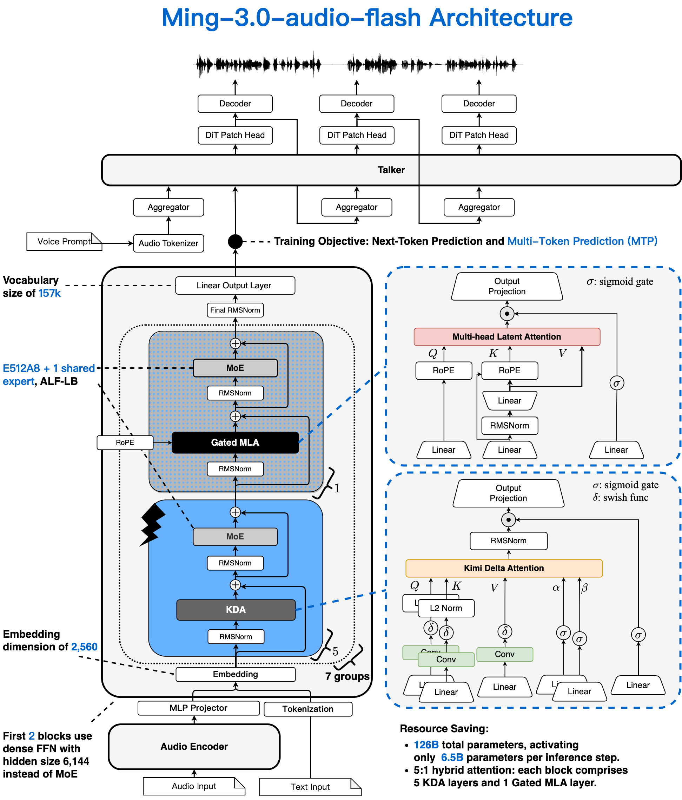
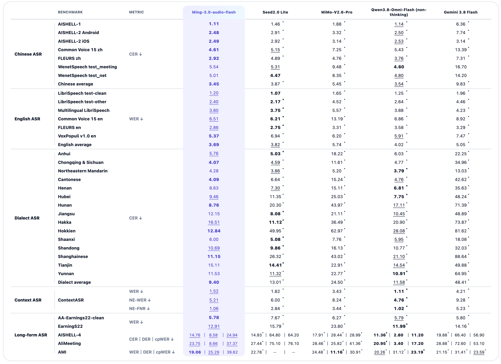
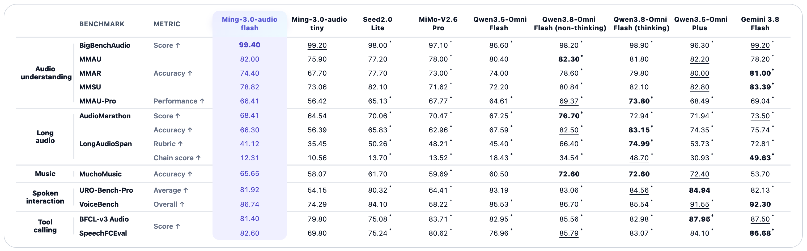

<div align="center">

# Ming-3.0-audio-flash

### Hear clearly. Understand deeply. Act intelligently.

A native audio model built for real-world speech recognition, audio understanding,
reasoning, and end-to-end spoken interaction.

[](LICENSE)
[](requirements-transformers.txt)
[](requirements-vllm-omni.txt)

[Hugging Face · Flash](https://huggingface.co/inclusionAI/Ming-3.0-audio-flash)
· [Hugging Face · Tiny](https://huggingface.co/inclusionAI/Ming-3.0-audio-tiny)
· [ModelScope · Flash](https://modelscope.cn/models/inclusionAI/Ming-3.0-audio-flash)
· [Cookbook](cookbook.ipynb)
· [Examples](examples/README.md)

</div>

---

## 🧩 Model Variants

- **[Ming-3.0-audio-flash](https://huggingface.co/inclusionAI/Ming-3.0-audio-flash)** —
  The model documented in this repository and used by the examples and
  benchmark results below.
- **[Ming-3.0-audio-tiny](https://huggingface.co/inclusionAI/Ming-3.0-audio-tiny)** —
  A compact member of the Ming-3.0-audio family. See its model card for
  checkpoint details and usage guidance.

## ✨ Highlights

- 🎙️ **Complex speech recognition** — Recognizes Chinese and English speech
  across dialects, accents, noisy environments, and multi-speaker meetings.
- ⏱️ **Long-audio understanding** — Comprehends and analyzes recordings up
  to hours in length.
- 🎧 **Multi-dimensional perception** — Understands fine-grained speech,
  non-speech sounds, acoustic scenes, and music.
- 💡 **Audio reasoning** — Analyzes and reasons directly over audio content.
- 🗣️ **Audio interaction** — Supports end-to-end spoken dialogue with optional
  synthesized speech output.

Ming-3.0-audio-flash closes the loop from **hearing the sound**, to
**understanding the information**, to **getting the task done**.

## 🏗️ Architecture

[](assets/ming-3.0-audio-flash-architecture.png)

## 📊 Benchmarks

All scores are reported as percentages. ↑ means higher is better, while ↓
means lower is better. Ming-3.0-audio-flash is evaluated in non-thinking mode.
**Bold** indicates the best result, <u>underlined</u> indicates the second-best
result, and an asterisk (`*`) indicates results obtained in our own evaluation.

### Speech Recognition

[](assets/benchmark-asr.png)

### Audio Intelligence

[](assets/benchmark-audio-intelligence.png)

> [!NOTE]
> Results for comparison models are reproduced under our evaluation setup and
> may differ from their official reports due to differences in prompts,
> decoding settings, model versions, and evaluation pipelines.

## 🧭 Inference Options

| | vLLM-Omni | Transformers |
| --- | --- | --- |
| Best for | Serving and application integration | Local evaluation and research |
| Input | Audio + text instruction | Audio + text instruction |
| Output | Text, or text + speech | Text |
| Interface | OpenAI-compatible API | Hugging Face AutoClass |
| Dependencies | `requirements-vllm-omni.txt` for the server; `requirements-client.txt` for the client | `requirements-transformers.txt` |

## 🚀 Quick Start

### 1️⃣ Download the Model

```bash
pip install -U huggingface_hub
hf download inclusionAI/Ming-3.0-audio-flash \
  --local-dir inclusionAI/Ming-3.0-audio-flash

export MODEL_PATH="$PWD/inclusionAI/Ming-3.0-audio-flash"
```

<details>
<summary>Download from ModelScope</summary>

```bash
pip install -U modelscope
modelscope download --model inclusionAI/Ming-3.0-audio-flash \
  --local_dir inclusionAI/Ming-3.0-audio-flash \
  --revision master

export MODEL_PATH="$PWD/inclusionAI/Ming-3.0-audio-flash"
```

</details>

The model directory contains the tokenizer, processor, model implementation,
checkpoint shards, and Talker assets. Large model files are distributed through
Hugging Face and ModelScope rather than this GitHub repository.

### 2️⃣ Start a Server

Install the Ming-3.0-audio-flash branch of
[inclusionAI/vllm-omni](https://github.com/inclusionAI/vllm-omni/tree/model/ming3-audio-flash):

```bash
python3 -m venv .venv-vllm-omni
source .venv-vllm-omni/bin/activate
pip install -r requirements-vllm-omni.txt
```

This branch contains the `bailing_moe_v3_audio` pipeline and the current Ming
Talker request interface. It supports IP voice routing through `voice_mode`
and voice cloning through `ref_audio` plus `prompt_text`. Legacy builds that
only support `voice_name` are incompatible with the speech-output examples
below.

Start text-output serving for audio understanding and reasoning:

```bash
MING_OUTPUT_MODE=text ./scripts/serve.sh "$MODEL_PATH"
```

Use the ASR profile when reproducing recognition evaluations with 10-gram
blocking support:

```bash
MING_OUTPUT_MODE=asr ./scripts/serve.sh "$MODEL_PATH"
```

Or enable both text and synthesized speech output:

```bash
MING_OUTPUT_MODE=audio ./scripts/serve.sh "$MODEL_PATH"
```

For Ming-3.0-audio-tiny, point `MODEL_PATH` to the Tiny checkpoint and select
the Tiny deployment profiles:

```bash
export MODEL_PATH="$PWD/inclusionAI/Ming-3.0-audio-tiny"
MING_MODEL_VARIANT=tiny MING_OUTPUT_MODE=text ./scripts/serve.sh "$MODEL_PATH"
```

`scripts/serve.sh` also detects Tiny automatically when the model directory
name contains `tiny`. Set `MING_MODEL_VARIANT` explicitly when using a custom
directory name.

> [!NOTE]
> The Flash deployment profiles use four GPUs for the thinker, and the full
> profile also places the Talker on GPU 3. Tiny uses one GPU and reuses it for
> the Talker. Adjust `devices`, sequence limits, and `gpu_memory_utilization`
> in `deploy/*.yaml` for your hardware.

### 3️⃣ Send a Request

```bash
pip install -r requirements-client.txt
```

**Speech recognition**

```bash
python examples/vllm_omni_audio_chat.py examples/audio/introduce_ant_group.wav \
  --task asr \
  --prompt "Please recognize the language of this speech and transcribe it, placing a ‘\t’ between the identified language and the transcribe." \
  --max-tokens 256 \
  --no-repeat-ngram-size 10
```

**Spoken response**

```bash
python examples/vllm_omni_audio_chat.py examples/audio/introduce_ant_group.wav \
  --audio-response \
  --output-audio outputs/answer.wav
```

By default, the Talker uses IP voice routing and selects a built-in voice for
the response language. The English IP voice is `US_Stella`. To clone a voice
from a reference WAV:

```bash
python examples/vllm_omni_audio_chat.py examples/audio/introduce_ant_group.wav \
  --audio-response \
  --ref-audio path/to/reference.wav \
  --prompt-text "<exact transcript of the reference audio>" \
  --output-audio outputs/cloned_answer.wav
```

**Streaming spoken response with latency metrics**

```bash
python examples/vllm_omni_audio_streaming.py examples/audio/introduce_ant_group.wav \
  --output-audio outputs/stream_answer.wav
```

The clients use `http://localhost:8091/v1` by default and automatically select
the first model returned by `/v1/models`. Override the connection with
`--base-url`, `--api-key`, and `--model`, or the corresponding `MING_*`
environment variables.

## 🤗 Transformers Inference

Use an isolated environment for direct inference:

```bash
python3 -m venv .venv-transformers
source .venv-transformers/bin/activate
pip install -r requirements-transformers.txt
```

**Speech recognition**

```bash
python examples/transformers_audio.py examples/audio/introduce_ant_group.wav \
  --model "$MODEL_PATH" \
  --task asr \
  --prompt "Please recognize the language of this speech and transcribe it, placing a ‘\t’ between the identified language and the transcribe." \
  --max-new-tokens 256 \
  --no-repeat-ngram-size 10
```

**Spoken question answering**

```bash
python examples/transformers_audio.py examples/audio/introduce_ant_group.wav \
  --model "$MODEL_PATH" \
  --prompt "Answer the question or follow the instruction in the audio."
```

**Thinker + native Talker**

Use the Talker implementation bundled with the model to generate speech
without starting a vLLM-Omni server:

```bash
python examples/transformers_thinker_talker.py \
  --model "$MODEL_PATH" \
  --audio examples/audio/introduce_ant_group.wav \
  --prompt "Answer the question or follow the instruction in the audio." \
  --ip-name US_Stella \
  --thinker-max-memory 72GiB \
  --output outputs/answer.wav
```

Reference-audio voice cloning is also supported:

```bash
python examples/transformers_thinker_talker.py \
  --model "$MODEL_PATH" \
  --audio examples/audio/introduce_ant_group.wav \
  --prompt "Answer the question or follow the instruction in the audio." \
  --ref-audio path/to/reference.wav \
  --prompt-text "<exact transcript of the reference audio>" \
  --output outputs/cloned_answer.wav
```

> [!IMPORTANT]
> Direct inference loads the model's registered AutoClasses with
> `trust_remote_code=True`. Review downloaded model code before enabling remote
> code in your environment. Native speech output additionally imports the
> Talker implementation bundled in the model directory.

## 📚 More Examples

- Explore task-specific prompts in [`examples/README.md`](examples/README.md).
- Run the interactive walkthrough in [`cookbook.ipynb`](cookbook.ipynb).
- Inspect the bundled sample and metadata in [`examples/audio/`](examples/audio/).

## 🗂️ Repository Layout

```text
Ming-3.0-audio-flash/
├── cookbook.ipynb                  # Interactive walkthrough
├── deploy/                         # vLLM-Omni deployment profiles
├── examples/
│   ├── audio/                      # Sample audio and metadata
│   ├── vllm_omni_audio_chat.py      # Text and non-streaming speech client
│   ├── vllm_omni_audio_streaming.py # Streaming speech and latency metrics
│   ├── transformers_thinker_talker.py # Direct Thinker-to-Talker inference
│   └── transformers_audio.py       # Direct Transformers inference
├── scripts/
│   └── serve.sh                    # vLLM-Omni launcher
├── requirements-client.txt         # Lightweight API client dependencies
├── requirements-vllm-omni.txt      # Compatible vLLM-Omni server branch
└── requirements-transformers.txt   # Direct inference dependencies
```

## 🔌 API Format

The OpenAI-compatible endpoint accepts audio as a base64 data URL:

```python
messages = [
    {
        "role": "user",
        "content": [
            {"type": "text", "text": "Describe this audio."},
            {
                "type": "audio_url",
                "audio_url": {"url": "data:audio/wav;base64,..."},
            },
        ],
    }
]
```

Use `modalities=["text"]` for text output or
`modalities=["text", "audio"]` for text and synthesized speech.

Talker IP voice routing uses:

```python
additional_information = {"voice_mode": "ip"}
```

Reference-audio voice cloning uses raw base64 audio and its transcript:

```python
additional_information = {
    "ref_audio": reference_audio_base64,
    "prompt_text": reference_audio_transcript,
}
```

## 📄 License

This project is released under the [MIT License](LICENSE). See [LEGAL.md](LEGAL.md)
for the legal disclaimer.
